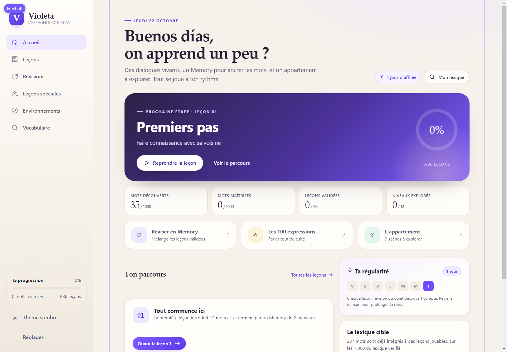
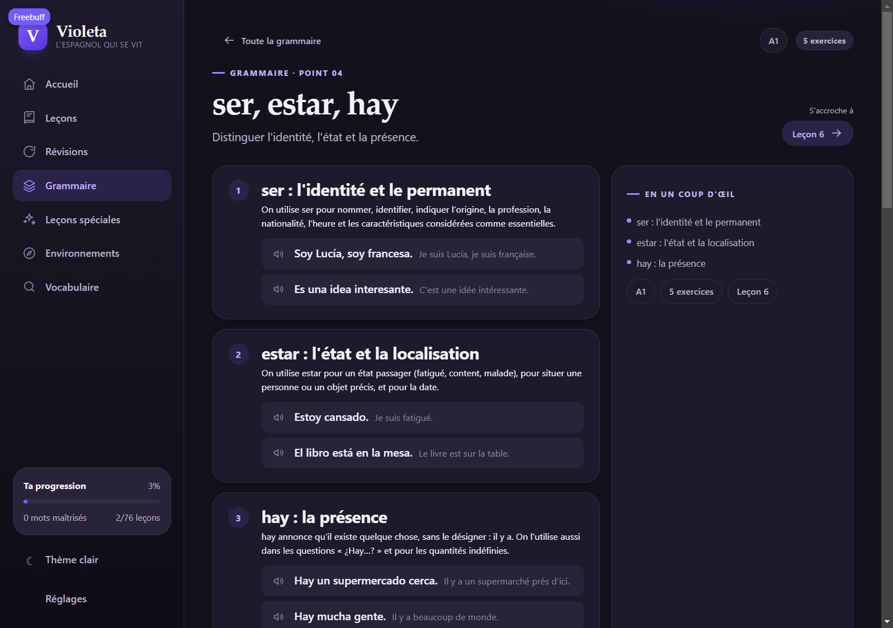
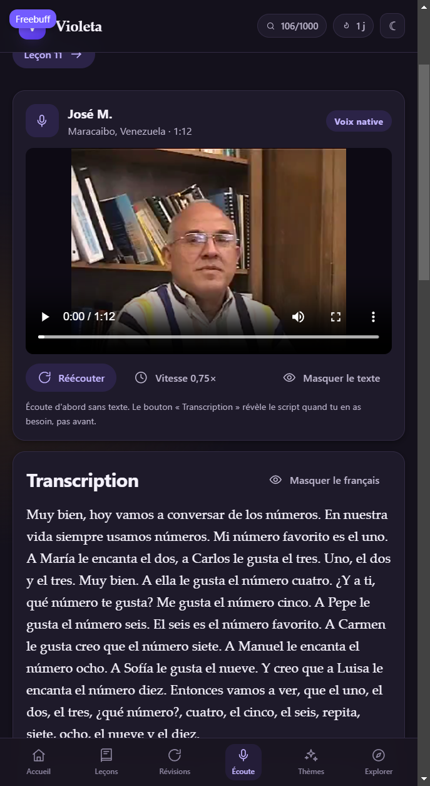
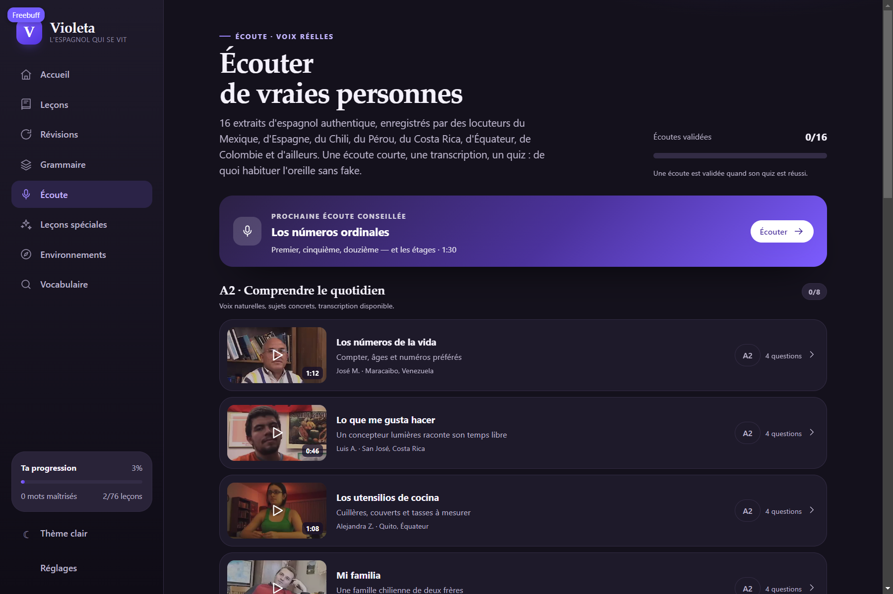
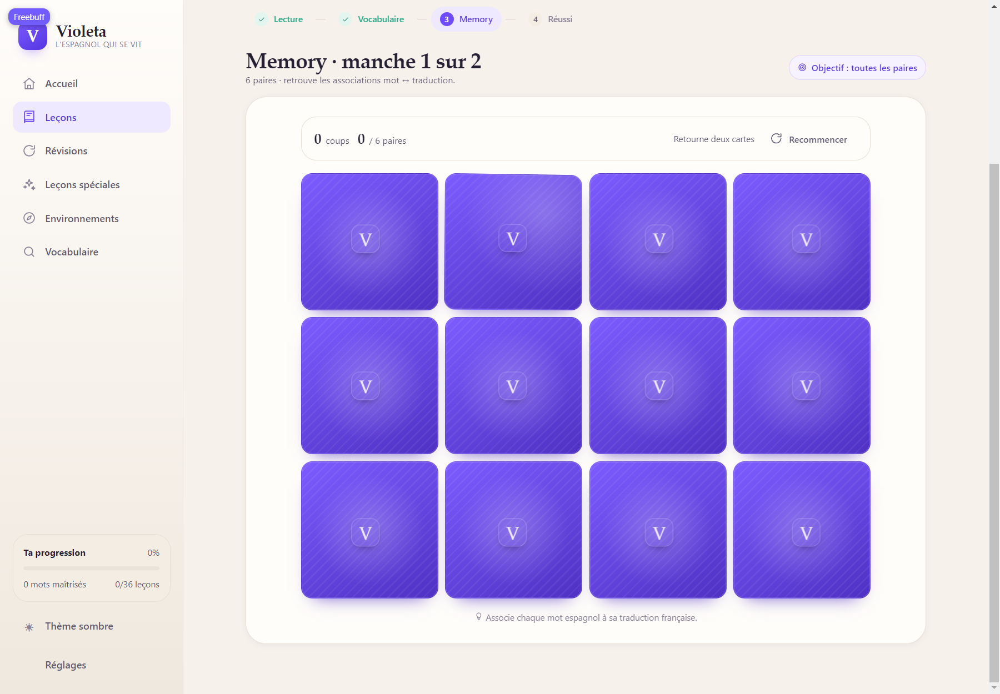

# Violeta — l'espagnol qui se vit

**Apprendre l'espagnol depuis le français, avec de vrais dialogues, la voix de
locuteurs natifs et une progression qui reste sur l'appareil.** 76 leçons,
1 000 mots, 16 compréhensions orales, 19 points de grammaire et 6 tests de
niveau — sans compte, sans build, sans collecte de données.




*Interface en français, langue enseignée : l'espagnol. Thème clair, sombre ou
système.*

> **In English** — Violeta is a French-first Spanish course: 76 dialogue
> lessons, 1,000 curated words, 16 native-speaker listening clips with
> transcripts and quizzes, 19 grammar points and 6 level tests. Bun serves the
> ES modules directly; progress lives in `localStorage`. No account, no build
> step, no tracking. Code MIT, listening media CC BY 4.0 (see
> [docs/CREDITS.md](docs/CREDITS.md)).

## Aperçu

| Grammaire | Compréhension orale |
| --- | --- |
|  |  |
| 19 points hors parcours, suggérés après la leçon qui les illustre | Vidéo locale, transcription bilingue, vitesse 0,75× et quiz |

| Parcours d'écoute | Memory |
| --- | --- |
|  |  |
| 16 voix natives, de Mexico à Santiago | Valider les mots d'une leçon en retournant des cartes |

## Lancer

```bash
git clone https://github.com/maxime-fleury/violeta.git
cd violeta
bun install     # une seule fois (@types/bun)
bun run dev     # http://localhost:3000 (port suivant si occupé)
```

Aucune étape de build : Bun sert `public/` tel quel. L'application fonctionne
hors ligne après le premier chargement, vidéos comprises.

Vérifications de contenu :

```bash
bun run check    # lexique + contrôle éditorial complet
# équivaut à :
bun scripts/build-lexicon.mjs --check   # 1 000 entrées, ids uniques, exemples complets
bun scripts/validate-content.mjs        # leçons, thèmes, environnements, couverture
```

## Ce qui fonctionne réellement

| Domaine | État |
| --- | --- |
| Tableau de bord | Progression, série de jours, leçon à reprendre, dernières validations |
| Parcours principal | **76 dialogues** originaux, **792 mots ciblés**, 813 répliques |
| Lecture | Mots jamais vus en violet, traduction au survol / toucher / clavier, audio navigateur, traduction par réplique |
| Validation | Memory en 1 ou 2 manches selon le nombre de mots, statistiques de coups, écran de réussite |
| Récits de révision | **7 histoires**, une tous les dix leçons, qui ne réutilisent que le vocabulaire déjà vu (79 à 97 %), avec lecture à voix haute conseillée, audio lent et quiz |
| Grammaire | **19 points séparés du parcours** (A1 10 · A2 5 · B1 4), 3 règles et un tableau par point, 95 exercices corrigés — suggérés dans le parcours après la leçon qui les illustre |
| Tests de niveau | **6 épreuves finales** : grammaire et vocabulaire pour A1, A2 et B1, 12 questions chacune, 10 pour valider ; résultats et meilleur score enregistrés |
| Compréhensions orales | **16 vidéos locales** de voix natives (Mexique, Espagne, Chili, Pérou, Costa Rica, Équateur, Colombie…), 33 à 90 s, transcription espagnole + traduction, glossaire, quiz de 4 questions — [sous licence CC BY 4.0](docs/CREDITS.md) |
| Révisions | Sélection des leçons validées, difficulté, priorité aux mots ratés, dédoublonnage |
| Leçons spéciales | 6 thèmes visuels + **10 leçons de 10 expressions** (100 expressions) |
| Environnements | Appartement (6 pièces, 9 niveaux), supermarché (2), gare (1) — **12 niveaux, 94 objets** |
| Vocabulaire | 1 000 entrées consultables, recherche, filtres, état découvert / maîtrisé |
| Progression | Sauvegarde locale versionnée, export JSON, réinitialisation confirmée |
| Apparence | Thème clair, sombre ou système — sans flash au chargement, choix persistant |
| Responsive | Mobile, tablette, ordinateur ; aucune fonction essentielle au survol seul |
| Accessibilité | Navigation clavier, focus visibles, `aria-live`, contrastes vérifiés dans les deux thèmes |

Le lexique cible est **intégralement couvert** : `bun scripts/validate-content.mjs`
affiche 1 000 mots sur 1 000 intégrés à du contenu jouable (792 cibles
déclarées, 967 lemmes distincts lus dans les dialogues, 52 mots des thèmes,
74 objets des environnements, avec les recoupements). Un mot reste
« à découvrir » tant que l'apprenant ne l'a pas rencontré, et « maîtrisé »
qu'après trois réussites : la couverture du programme n'est pas la maîtrise.

## Niveau atteint à la fin du parcours

Avec les 76 leçons, les 16 thèmes et les 12 niveaux d'exploration, un
francophone qui part de zéro atteint un **A2 solide** :

- se présenter, parler de sa famille, de son logement, de son travail ;
- commander, payer, demander son chemin, prendre un billet, faire ses courses ;
- décrire un symptôme chez le médecin, négocier au marché, comprendre une offre d'emploi ;
- raconter une journée au présent, au passé composé et à l'imparfait ;
- comprendre et produire des phrases du quotidien (environ
  967 lemmes rencontrés, 792 travaillés activement).

Les 19 points de grammaire ajoutent les structures qui manquaient au parcours :
futur synthétique, conditionnel, subjonctif présent, connecteurs, passif et
« se » impersonnel. Cela permet de **vérifier** un B1 en grammaire, pas de le
certifier : le volume lu reste celui d'un A2 solide, la production écrite n'est
pas corrigée et les 15 minutes d'écoute authentique ne remplacent pas des
conversations. Les tests de niveau affichent donc un résultat par domaine, pas
un diplôme.

## Architecture

```
content/
  seed/            liste curatée (es|fr|catégorie) — 1 000 entrées
  lexicon/         exemples et variantes par lot (générés puis relus)
  sources/         rangs de fréquence mesurés + provenance
  work/            lots de travail (génération)
public/
  index.html       coquille, favicon, thème appliqué avant le premier rendu
  styles.css       design system (variables clair/sombre)
  js/
    app.js         routeur, navigation, thème
    core/          lemma, curriculum, memory, progress, stats, store, theme, grammar, listening, tests
    data/          lexicon, lessons, recits, specials, expressions, environments, grammar, listenings
    components/    dialogue, memory-board, quiz
    views/         dashboard, lessons, lesson, recit, grammar, grammar-lesson, listenings, listening, test, reviews, specials, environment…
public/media/ecoute/  16 vidéos compressées (19,7 Mo) + vignettes, CC BY 4.0
docs/
  CONTENT.md       décisions éditoriales et structure des données
  CREDITS.md       attribution détaillée des 16 extraits CC BY 4.0
  screenshots/     captures utilisées par ce README
scripts/
  build-lexicon.mjs    construit public/js/data/lexicon.js depuis les seeds
  fetch-listening-media.sh  télécharge et compresse les vidéos d'écoute
  validate-content.mjs contrôle éditorial et couverture
```

Règles structurantes :

- les contenus sont des données, jamais du HTML codé dans un composant ;
- chaque mot, leçon, niveau et environnement a un identifiant stable ;
- un mot n'existe qu'une fois : le même identifiant sert au dialogue, au Memory,
  au lexique et aux scènes ;
- la progression est un objet unique, versionné, migré par `sanitizeProgress`.

## Le surlignage violet

Un mot est violet quand l'apprenant ne l'a **jamais rencontré dans une leçon
précédente** — pas seulement les dix mots ciblés. Les prénoms et les mots hors
lexique restent en couleur normale. Un mot compte comme découvert dès qu'il est
affiché, et comme maîtrisé après trois réussites.

## Sources du lexique

- [Wiktionary — Spanish 1000](https://en.wiktionary.org/wiki/Wiktionary:Frequency_lists/Spanish1000)
  (sous-titres de films et séries, 27,4 M de mots) — rang du lemme.
- [hermitdave/FrequencyWords — es_50k](https://github.com/hermitdave/FrequencyWords)
  (OpenSubtitles 2018) — comparaison des fréquences de surface.

La fréquence brute a été corrigée à la main : les mots trop spécialisés ont été
écartés au profit de salutations, objets du quotidien, nombres et couleurs
réellement utiles en A1. Le détail éditorial est dans `docs/CONTENT.md`.

## Vérifications effectuées

- `build-lexicon --check` : 1 000 entrées, 1 000 exemples, identifiants uniques.
- `validate-content.mjs` : 76 leçons, 1000/1000 mots couverts, 16 thèmes, 3 environnements, 19 points de grammaire, 16 écoutes, 6 tests de niveau, 0 anomalie.
- Homographes accentués : `el`/`él`, `si`/`sí`, `se`, `este`, `tu`/`tú`,
  `mi`/`mí` résolus sur la forme exacte — l'article n'est plus surligné comme
  le pronom et les infobulles affichent le bon sens.
- Parcours navigateur (Chromium) : tableau de bord, leçons 57, 66, 74 et 76
  validées jusqu'à la réussite (deux manches de Memory pour 11 mots), session
  de révision, thèmes, appartement (objet trouvé → compteur), vocabulaire
  (1000/1000), réglages, thème clair et sombre, rechargement avec progression
  conservée.
- Récit `r10` joué de bout en bout : lecture, traduction par paragraphe, mode
  lent, mention « lu à voix haute », quiz 5/5, progression écrite dans
  `localStorage`, carte du parcours passée à « Lu ».
- Grammaire `g01` jouée jusqu'au bout : 5 exercices corrigés, point marqué
  validé, suggestion suivante (`g02`) affichée dans le parcours et sur l'accueil.
- Tests de niveau : `a1-vocabulaire` réussi 12/12 puis refait à 5/12 — le
  meilleur score et la validation restent conservés ; `a1-grammaire` vérifié
  sur ses 12 questions (choix et saisie), verrouillage A2/B1 affiché.
- Écoutes `eo01` et `eo14` : vidéo lue (72 s et 90 s), transcription et
  traduction affichées, vitesse 0,75× vérifiée, quiz 4/4, progression écrite
  puis nettoyée après test ; vignettes et lecteur contrôlés sur mobile.
- Mobile 390 × 844 : lecture, Memory, réglages, navigation par barre inférieure.
- Console navigateur : aucune erreur après correction des imports manquants.

## Limites connues

- Les 1 000 mots sont désormais dans le parcours, mais beaucoup ne sont vus
  qu'une ou deux fois : la consolidation repose sur les révisions et sur la
  lecture, pas sur le nombre de leçons.
- Trois environnements sur les sept prévus (hôpital, restaurant, ville, école,
  bureau restent à écrire) ; l'architecture les accepte sans nouveau code.
- 967 lemmes rencontrés dans les dialogues : certains mots fréquents hors liste
  (`lado`, `mejor`, `verdad`) n'ont pas encore d'infobulle.
- Les compréhensions orales sont de l'espagnol authentique, non ralenti : elles sont classées A2/B1, pas A1, et demandent souvent deux écoutes. Le débit reste celui d'un locuteur natif.
- Les vidéos d'écoute pèsent 19,7 Mo dans le dépôt (compressées depuis les sources) ; c'est le prix de l'usage hors ligne. Attribution CC BY 4.0 affichée sur chaque page, dans `docs/CONTENT.md` et dans `docs/CREDITS.md`.
- L'audio dépend de la voix espagnole installée sur l'appareil.
- La progression est locale à un navigateur : l'export JSON permet de la
  transférer, il n'y a pas de compte ni de synchronisation.

## Licence et attribution

- **Code et contenus pédagogiques originaux** (dialogues, récits, grammaire,
  tests, traductions, quiz) : licence **MIT** — voir [LICENSE](LICENSE).
- **16 extraits vidéo** : *Spanish Proficiency Exercises*, COERLL, University of
  Texas at Austin, sous **CC BY 4.0**. Ils ne sont pas couverts par la licence
  MIT ; l'attribution complète, les modifications apportées et la liste des
  extraits figurent dans [docs/CREDITS.md](docs/CREDITS.md).
- **Lexique** : rangs de fréquence dérivés de Wiktionary et d'OpenSubtitles,
  cités dans la section « Sources du lexique ».

Violeta est un projet indépendant, sans affiliation avec l'Université du Texas.

## Contribuer

Les contenus sont des données, pas du HTML : `public/js/data/` pour les leçons,
les points de grammaire, les écoutes et les tests, `content/` pour le lexique.
Après toute modification éditoriale, `bun run check` doit rester vert. Les
captures d'écran de travail ne sont pas versionnées ; `docs/screenshots/` ne
contient que celles utilisées par ce README.
